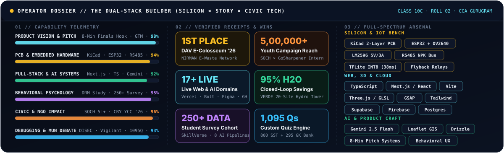
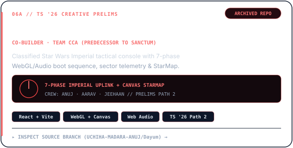
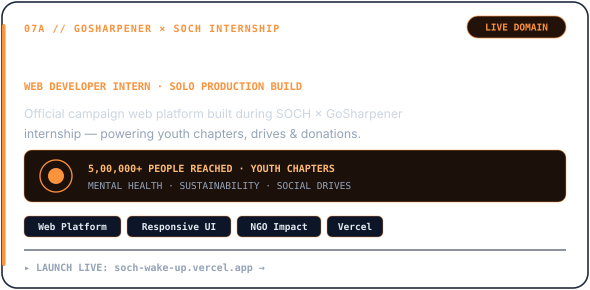
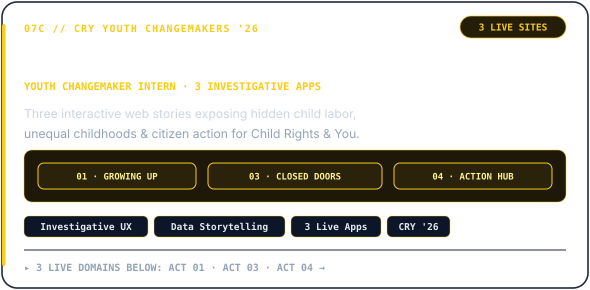
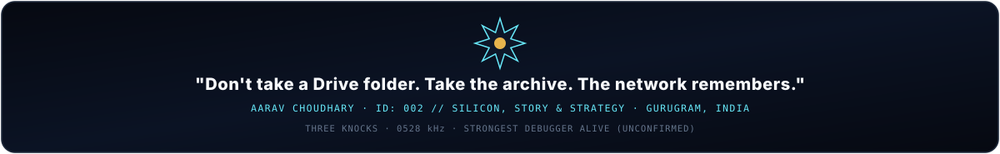

<!-- ═══════════════════════════════════════════════════════════════════════════
     AARAV CHOUDHARY — MASTER GITHUB PROFILE
     https://github.com/aarav-choudhary-pro
     ID: 002 // Product Visionary · KiCad Hardware Lead · Civic-Tech Builder
     ═══════════════════════════════════════════════════════════════════════════ -->

  

  &nbsp;
  &nbsp;
  &nbsp;
  

  
    <a href="#-operator-dossier"><b>00 · Dossier</b></a> &nbsp;·&nbsp;
    <a href="#-flagship-systems--co-founded-ventures"><b>01 · Flagship Systems</b></a> &nbsp;·&nbsp;
    <a href="#-solo-impact-internships--engineering-vault"><b>02 · Solo Impact Vault</b></a> &nbsp;·&nbsp;
    <a href="#-the-council--team-cca"><b>03 · Team CCA</b></a> &nbsp;·&nbsp;
    <a href="#-beyond-the-terminal"><b>04 · Beyond Code</b></a> &nbsp;·&nbsp;
    <a href="#-master-live-domain-registry"><b>05 · All Live Domains</b></a>
  

## ⦿ Operator Dossier

Most student builders stay inside a single browser tab. My work lives where **two-layer copper PCBs**, **behavioral psychology**, and **high-conviction product storytelling** meet — soldering **LM2596 buck converters and RS485 sensor buses** on physical vertical-farming hardware one week, shipping **NGO platforms reaching 5,00,000+ citizens** the next, and holding the **eight-minute Finals hook** on stage when it counts.

  

## ⦿ Flagship Systems & Co-Founded Ventures

Every banner below is a bespoke animated schematic wired directly to its live deployment. Use the cockpit switches beneath each card to jump into every hosted build, or open the classified drawer for unlock protocols and technical architecture.

  

<!-- ═══════════════════ 01 · PROJECT SANCTUM ═══════════════════ -->

  

  &nbsp;
  &nbsp;
  &nbsp;
  &nbsp;
  

  
<b>▸ DECLASSIFY SANCTUM // Unlock Protocols, 4-Act Architecture &amp; My Role</b>

   

  - **Event & Crew**: **TS '26 Creative (Tech Syndicate)** · **Team CCA** (*Aarav Choudhary · Jeehaan Kwatra `@AlphabuggOp` · Anuj Phulera `@UCHIHA-MADARA-ANUJ`*).
  - **My Role (`Product & Story`)**: *"Wrote the world. Holds the eight-minute hook."* Authored the universe lore, product thesis, and delivered **Slides 01–03 (Hook, Problem, Idea)** and **Slides 10–12 (Why It Wins, Summary, Close)** in the 8-minute Finals script, plus hosted the unified Archive on Vercel.
  - **How to Enter the Three Live Doors**:
    1. **The Archive (`ts-creative-the-protfolio.vercel.app`)**: Append **`/?unlock`**, OR open the dead shortwave radio blog (*SIGNAL & STATIC*), find the ring in the photo drawer, **click 3 times**, and enter frequency **`0528`**.
    2. **The Main Network (`ts-creative.vercel.app`)**: On *SIGNAL & STATIC*, knock **3 times** on the ring and enter **`0528`** → boots into **Act 0 (The Seal)** → **Act 1 (620vh GLSL Hyperspace Gate)** → **Act 2 (Signal, Focus & Choice Rites + Proof Games)** → **Act 3 (Holo-Map, Dead-Drop Cipher, A* Safe-Lane Router, 19 Field Log Quests & Beacon Forge)**.
    3. **The WebGL Pitch Deck (`project-sanctum-ppt.vercel.app`)**: Disguised as the 1998 *Andoria Deep-Sky Archive* Geocities astronomy blog → open **Gallery → Fig. 5 (*Unidentified object, 14 Nov 1998*)**, click **3 times**, enter protocol **`HIDE`** → 12 live Three.js/GLSL slides.
    4. **Emergency Controls**: Press **`~`** at any moment to panic-vanish back into the decoy blog; press **`D`** in the Archive to wipe local clearance.

 

<!-- ═══════════════════ 02 · PROJECT VERDE ═══════════════════ -->

  

  &nbsp;
  &nbsp;
  &nbsp;
  &nbsp;
  &nbsp;
  

  
<b>▸ DECLASSIFY VERDE // 2-Layer KiCad PCB Specs, Sensor Bus &amp; Attribution</b>

   

  - **Circuits & Competitions**: Built across **CBSE Science Exhibition**, **DAV ACON 5 (`WEBX` V3.0)**, and **Tulsi Tech** with **Anuj Phulera** (`@UCHIHA-MADARA-ANUJ`).
  - **My Role (`02 · Hardware, PCB & Electronics Lead` + `Interface & Data` on V3.0)**:
    - Designed the **custom 2-layer KiCad PCB**, replacing fragile breadboard wiring with solid power/signal planes.
    - Engineered the **12V → 5V/3A LM2596 buck converter** power rail, **4-channel relay switching stage with flyback diode protection** for pumps/solenoids, and **physical 4-tier, 20-plant closed-loop vertical tower** saving **95% water** vs. soil farming.
    - Integrated **industrial RS485 NPK sensing**, **pH**, **TDS**, **DHT22**, and **ESP32-CAM OV2640** feeding a **38ms INT8 quantized TFLite** leaf-health classifier + cloud **VERDE OS Mission Control**.

 

<!-- ═══════════════════ 03 · NIRMAN ═══════════════════ -->

  

  &nbsp;
  &nbsp;
  &nbsp;
  &nbsp;
  

  
<b>▸ DECLASSIFY NIRMAN // DAV E-Colosseum '26 Win, 4-Role GIS Flow &amp; My Role</b>

   

  - **Award & Trajectory**: **🏆 1st Place Winner at DAV E-Colosseum '26**, subsequently expanded for the **Bharat Innovation Challenge** with co-founder **Anuj Phulera**.
  - **My Role (`Co-Founder · Product Visionary & GTM Strategist` — featured at `/team/aarav`)**:
    - Conceived the *"Swiggy / Uber for E-Waste"* 4-tier marketplace (**Household User → Verified Recycler Partner → Admin KYC Verifier → Database Owner**) addressing India's **14.14-lakh-tonne** annual e-waste crisis.
    - Specified the **4-step Partner KYC Appeal & Leaflet.js + Nominatim draggable-pin geocoding workflow**, ensuring only admin-verified CPCB recyclers (**76 hubs + 140 smart bins**) surface on customer pickup maps, paired with **EcoBot AI** and real-time environmental impact analytics.

 

<!-- ═══════════════════ 04 · RESONATE ═══════════════════ -->

  

  &nbsp;
  &nbsp;
  &nbsp;
  &nbsp;
  &nbsp;
  

  
<b>▸ DECLASSIFY RESONATE // 5-App Universe, Custom GLSL Shaders &amp; My Role</b>

   

  - **Hackathons**: Submitted to the **Foru.ms × v0 by Vercel Hackathon** on Devpost and developed for **Bharat Innovation Challenge Stage-1** with co-founder **Anuj Phulera**.
  - **My Role (`Co-Founder · ID: 002 // VISIONARY`)**:
    - Co-created the anti-vanity social model eliminating public like counts in favor of **30-second raw voice/story "Echoes"** woven into collaborative **"Tapestries"** and **Gemini-verified "Good Quests"** that reward vulnerability and kindness with XP.
    - Worked across backend verification flows, emotional dataset edge cases, business modeling (**$50M Y1 TAM** executive deck on Figma Make), and the 5-product constellation (**Quest App · Echo Studio · Tapestry Hub · Mirage Lab · Resonance Circles**) spanning **52 routes** and **3 custom GLSL shader pairs**.

 

<!-- ═══════════════════ 05 · SKILLVERSE ═══════════════════ -->

  

  &nbsp;
  &nbsp;
  

  
<b>▸ DECLASSIFY SKILLVERSE // 250+ Student Empirical Study &amp; 8 AI Pipelines</b>

   

  - **Competition**: Built for **DAV Screen2Skill 2026 (`GATECCA · Gurugram`, v9.9.1)**.
  - **My Role (`ID: 002 // VISIONARY — Ideator, Research & Strategy`)**:
    - Designed and executed the multi-stakeholder behavioral survey across **250+ students, educators, and parents** measuring passive screen-time habits vs. structured skill acquisition.
    - Translated those empirical findings into **8 Gemini 2.5 Flash AI skill-coaching pipelines**, **34 Next.js routes**, and **live Supabase telemetry charts** that turn passive scrolling into verifiable micro-skills.

 

<!-- ═══════════════════ 06A · OBSIDIAN & 06B · PROJECT VIKAS ═══════════════════ -->
<table width="100%">
  <tr>
    <td width="50%" align="center" valign="top">
      
    </td>
    <td width="50%" align="center" valign="top">
      
    </td>
  </tr>
</table>

  
<b>▸ DECLASSIFY OBSIDIAN &amp; PROJECT VIKAS // Prelims Tactical Console &amp; Vision 2047</b>

   

  - **06A · OBSIDIAN (`TS '26 Creative Prelims — Path 2`)**: Built by **Team CCA (Anuj · Aarav · Jeehaan)** as the classified Imperial counterpart prior to *Sanctum* — featuring a 7-phase WebGL + procedural Web Audio uplink boot sequence, sector threat feeds, and interactive Canvas StarMap (`UCHIHA-MADARA-ANUJ/Dayum`, branch `arena/01a00195-dayum`).
  - **06B · PROJECT VIKAS (`TechNova 2047 — Viksit Bharat 2047`)**: Built by **Team Vikaas (Aarav Choudhary & Anuj Phulera, CCA Grade 10)** — a multi-pavilion tricolor digital exhibition covering Solar, Wind, EV Mobility, Bioenergy, Rivers, Policy Schemes, and India's Net-Zero 2047 roadmap (`UCHIHA-MADARA-ANUJ/Asset-Manager-Vikas` · Replit `@eggeranderbroo2/Asset-Manager`).

## ⦿ Solo Impact, Internships & Engineering Vault

Production websites, NGO internship deliverables, cybersecurity tools, and standalone engines shipped independently under <code>aarav-choudhary-pro</code>. Click any card to launch the live deployment.

  

<table width="100%">
  <tr>
    <td width="50%" align="center" valign="top">
      
    </td>
    <td width="50%" align="center" valign="top">
      
    </td>
  </tr>
  <tr>
    <td width="50%" align="center" valign="top">
      
      

        &nbsp;
        &nbsp;
        
      

    </td>
    <td width="50%" align="center" valign="top">
      
    </td>
  </tr>
</table>

## ⦿ The Council // Team CCA

Great systems are built by sharp squads with zero overlap in ego and total overlap in standards. Every multi-disciplinary flagship above was forged alongside my two primary co-builders at <b>Colonel's Central Academy, Gurugram</b>:

  

  

  &nbsp;
  &nbsp;
  &nbsp;
  

## ⦿ Beyond the Terminal

  

## ⦿ Master Live Domain Registry

  
<b>▸ OPEN COMPLETE VERIFIED DIRECTORY // All 18 Live Hosted Websites &amp; Canonical Repos Featuring Aarav Choudhary</b>

   

  | # | Project | Live Hosted Domain / Link | Role / Credit | Host / Source |
  |---|---|---|---|---|
  | 01 | **PROJECT SANCTUM — The Archive** | [`ts-creative-the-protfolio.vercel.app`](https://ts-creative-the-protfolio.vercel.app/?unlock) | **Product & Story · 8-Min Hook** | Aarav Vercel · [`TS-CREATIVE-THEPROTFOLIO`](https://github.com/AlphabuggOp/TS-CREATIVE-THEPROTFOLIO) |
  | 02 | **PROJECT SANCTUM — Hidden Network App** | [`ts-creative.vercel.app`](https://ts-creative.vercel.app/) | **Team CCA Council (`0528`)** | [`AlphabuggOp/ts-creative`](https://github.com/AlphabuggOp/ts-creative) |
  | 03 | **PROJECT SANCTUM — WebGL Pitch Deck** | [`project-sanctum-ppt.vercel.app`](https://project-sanctum-ppt.vercel.app/) | **Team CCA Council (`HIDE`)** | [`AlphabuggOp/Ts-Creative-PPT`](https://github.com/AlphabuggOp/Ts-Creative-PPT) |
  | 04 | **Project VERDE — CBSE Compendium** | [`verde-cbse.vercel.app`](https://verde-cbse.vercel.app/) | **02 · Hardware & Electronics** | [`UCHIHA-MADARA-ANUJ/Verde-CBSE`](https://github.com/UCHIHA-MADARA-ANUJ/Verde-CBSE) |
  | 05 | **Project VERDE — VERDE OS v3.0 App** | [`verde-cbse-app.vercel.app`](https://verde-cbse-app.vercel.app/) | **Co-Builder · Hardware Telemetry** | [`UCHIHA-MADARA-ANUJ/VERDE-CBSE-APP`](https://github.com/UCHIHA-MADARA-ANUJ/VERDE-CBSE-APP) |
  | 06 | **Project VERDE — 3D Archive Site** | [`verde-main-portfolio.vercel.app`](https://verde-main-portfolio.vercel.app/) | **Co-Builder · Vertical Tower** | [`UCHIHA-MADARA-ANUJ/verde-main-portfolio`](https://github.com/UCHIHA-MADARA-ANUJ/verde-main-portfolio) |
  | 07 | **Project VERDE — Tulsi v2.0 Mission** | [`verde-app-main-tulsi.vercel.app`](https://verde-app-main-tulsi.vercel.app/) | **Co-Builder · ESP32 Stream** | [`UCHIHA-MADARA-ANUJ/Verde-App-Main`](https://github.com/UCHIHA-MADARA-ANUJ/Verde-App-Main) |
  | 08 | **NIRMAN — 16-Act Portfolio** | [`nirmaan-portfolio-main.vercel.app`](https://nirmaan-portfolio-main.vercel.app/) | **Co-Founder · DAV Winner** | [`UCHIHA-MADARA-ANUJ/Nirmaan-Portfolio-`](https://github.com/UCHIHA-MADARA-ANUJ/Nirmaan-Portfolio-) |
  | 09 | **NIRMAN — Dedicated `/team/aarav` Route** | [`nirmaan-portfolio-main.vercel.app/team/aarav`](https://nirmaan-portfolio-main.vercel.app/team/aarav) | **Product Visionary & GTM** | Dedicated Founder Dossier |
  | 10 | **NIRMAN — Live 4-Role Pickup App** | [`nirmaan-f3dr3oqkg-...vercel.app`](https://nirmaan-f3dr3oqkg-madaracodingprojects-9646s-projects.vercel.app/) | **Co-Founder · GIS & KYC Flow** | [`UCHIHA-MADARA-ANUJ/nirmaan-app`](https://github.com/UCHIHA-MADARA-ANUJ/nirmaan-app) |
  | 11 | **RESONATE — Algorithmic Sanctuary v1** | [`resonate-preview.vercel.app`](https://resonate-preview.vercel.app/) | **Co-Founder · `ID: 002`** | [`UCHIHA-MADARA-ANUJ/Resonate-`](https://github.com/UCHIHA-MADARA-ANUJ/Resonate-) |
  | 12 | **RESONATE — 52-Route GLSL Build v2** | [`resonate-portfolio-resonate-r3pv-cb2bngl2n.vercel.app`](https://resonate-portfolio-resonate-r3pv-cb2bngl2n.vercel.app/) | **Co-Founder · `ID: 002`** | [`UCHIHA-MADARA-ANUJ/Resonate-Portfolio`](https://github.com/UCHIHA-MADARA-ANUJ/Resonate-Portfolio) |
  | 13 | **RESONATE — Tapestry Hub** | [`tapestry-hub-uloe.bolt.host`](https://tapestry-hub-uloe.bolt.host/) | **Co-Founder · Emotional Galaxy** | Bolt.host Live Build |
  | 14 | **RESONATE — Executive Pitchdeck** | [`flute-cover-54901990.figma.site`](https://flute-cover-54901990.figma.site/) | **Co-Founder · $50M TAM Deck** | Figma Make Live Site |
  | 15 | **RESONATE — Devpost Submission** | [`devpost.com/software/resonate-vn53iz`](https://devpost.com/software/resonate-vn53iz) | **Co-Founder (`@aaravgurmeet`)** | Foru.ms × v0 Hackathon |
  | 16 | **SKILLVERSE — v9.9.1 Platform** | [`skillverse-xi.vercel.app`](https://skillverse-xi.vercel.app/) | **`ID: 002` · 250+ Survey Lead** | [`UCHIHA-MADARA-ANUJ/S2S`](https://github.com/UCHIHA-MADARA-ANUJ/S2S) |
  | 17 | **Wake Up SOCH (`SOCH × GoSharpener`)** | [`soch-wake-up.vercel.app`](https://soch-wake-up.vercel.app/) | **Solo · Web Dev Intern (5L+)** | Aarav Vercel |
  | 18 | **Vigilant AI (`GPCSSI CA-002 & CA044`)** | [`vigilant-ashen.vercel.app`](https://vigilant-ashen.vercel.app/) | **Lead Builder · Cyber Portal** | Aarav Vercel |
  | 19 | **CRY YCC '26 — Act 01 / 03 / 04 Trilogy** | [`act01`](https://act01-growingup.vercel.app/) · [`act03`](https://activity-3-ycc.vercel.app/) · [`act04`](https://act-4-aarav-ycc.vercel.app/) | **Solo · CRY YCC '26 Intern** | Aarav Vercel (3 Live Apps) |
  | 20 | **Quiz Mastermind (`1,095-Q Engine`)** | [`quiz-mastermind-aarav.vercel.app`](https://quiz-mastermind-aarav.vercel.app/) | **Solo Creator & Engineer** | Aarav Vercel |

## ⦿ Direct Uplink

Open to ambitious **hackathons**, **hardware + AI collaborations**, **civic-tech fellowships**, and **product sprints**.

- **Email**: [`aaravgurmeet@gmail.com`](mailto:aaravgurmeet@gmail.com)
- **Discord**: `iamaarav_68049` *(𝕬𝖆𝖗𝖆𝖛 ⚔️ ♾️ — "strongest debugger alive (unconfirmed)")*
- **Devpost**: [`devpost.com/aaravgurmeet`](https://devpost.com/aaravgurmeet)

 

  

