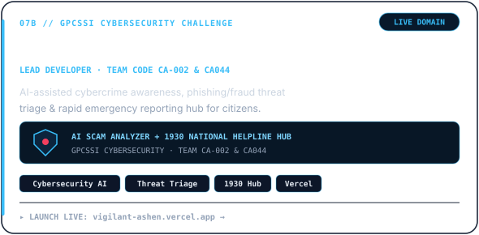

<!-- ═══════════════════════════════════════════════════════════════════════════════════════════
     BEAT 01 · 32-SECOND 4-ACT CINEMA OPENING ("PROTOCOL: CHILD EMPEROR // ID: 002")
     ═══════════════════════════════════════════════════════════════════════════════════════════ -->

 

<!-- Counter-Rotating S-Class Prodigy Reactor Seal -->

  <b>CODENAME: CHILD EMPEROR</b> · <code>ID // 002</code> · CLASS 10 PRODIGY ARCHITECT · GURUGRAM, INDIA 
  <i>"Anyone can ship a template mockup. I solder the 2-layer board, prove the psychology, and hold the eight-minute hook."</i>

<!-- Direct Operator Channels -->

  &nbsp;
  &nbsp;
  &nbsp;
  

Discord: <code>iamaarav_68049</code> &nbsp;·&nbsp; Colonel's Central Academy (Class 10C, Roll 02) &nbsp;·&nbsp; Status: <i>strongest debugger alive (unconfirmed)</i>

 

<!-- ═══════════════════════════════════════════════════════════════════════════════════════════
     BEAT 02 · S-CLASS PRODIGY REGISTRATION DOSSIER (SPLINE BARS + 6-AXIS HEX RADAR)
     ═══════════════════════════════════════════════════════════════════════════════════════════ -->

  

 

<!-- ═══════════════════════════════════════════════════════════════════════════════════════════
     BEAT 03 · ACTIVE DEPLOYMENT BUS (THREE PRIMARY FRONTS ONLINE RIGHT NOW)
     ═══════════════════════════════════════════════════════════════════════════════════════════ -->

  

---

## `01 // THE FIVE FLAGSHIP ECOSYSTEMS`

> Every flagship below is deployed on live production domains and paired with an animated schematic showing **what was physically or algorithmically built** and **where Aarav (`ID: 002`) drove the architecture, hardware, research, or Finals pitch**.

 

<!-- ─────────────────────────────────────── 01 · PROJECT SANCTUM ─────────────────────────────────────── -->

  
    
  &nbsp;
  &nbsp;
  &nbsp;
  

<b>🔓 CLASSIFIED TRANSMISSION — Click to reveal Covert Unlock Codes &amp; Aarav's Finals Architecture</b>

 

- **Aarav's Role (`Product & Story · Team CCA`)**: *"Wrote the world. Holds the eight-minute hook."* Authored the end-to-end rebellion narrative, operational doctrine, and **Finals Slides 01–03** (*Covert Entry, Threat Model, Doctrine*) & **Slides 10–12** (*Live Operational Finale — "Don't take a Drive folder. Take the Archive."*).
- **How to Unlock the Live Disguised Surfaces**:
  1. **Unlocked Archive (`?unlock`)**: [`ts-creative-the-protfolio.vercel.app/?unlock`](https://ts-creative-the-protfolio.vercel.app/?unlock) — Direct clearance into the 6-tab Command Dossier.
  2. **Covert App (`ts-creative.vercel.app`)**: Presents as an innocent civilian weather portal -> **Knock 3 times** on the crest -> Enter frequency **`0528`** -> Unlocks **16 playable subsystems** (*Sector Map, Saber Forge, Holocron Matrix, Hyperspace, Comms, Droid Calibration*).
  3. **Disguised Finals Deck (`project-sanctum-ppt.vercel.app`)**: Masquerades as the *1998 Andoria Deep-Sky Survey Archive* -> Open **Gallery Fig. 5**, click **3×**, type **`HIDE`** -> Reveals the 12-slide rebellion deck (**`~` Panic Key** snaps every surface back to civilian cover in `<16ms`).
- **Squad (`Team CCA`)**: **Aarav Choudhary** (*Product & Story*) · [**Jeehaan Kwatra (`@AlphabuggOp`)**](https://github.com/AlphabuggOp) (*Design & Motion*) · [**Anuj Phulera (`@UCHIHA-MADARA-ANUJ`)**](https://github.com/UCHIHA-MADARA-ANUJ) (*Engineering*).

 

<!-- ─────────────────────────────────────── 02 · PROJECT VERDE v3.0 ─────────────────────────────────────── -->

  
    
  &nbsp;
  &nbsp;
  &nbsp;
  &nbsp;
  

<b>⚡ SILICON BENCH SCHEMATIC — Click to inspect Aarav's 2-Layer KiCad PCB &amp; Hydroponic Tower Specs</b>

 

- **Aarav's Role (`02 · Hardware & Electronics Lead`)**: Engineered the physical **4-tier, 20-site vertical hydroponic tower** and custom **2-layer KiCad printed circuit board** bridging industrial agro-sensors with edge computer vision.
- **Board-Level Architecture**:
  - **Power Regulation**: `12V DC` main input stepped down via a **buck-regulated `LM2596` `5.0V / 3A` stage** with bulk decoupling to eliminate ESP32 brownouts under pump load.
  - **Actuation & Isolation**: Flyback-diode protected relay channels switching peristaltic nutrient dosing pumps and circulation lines.
  - **Sensor & Edge AI Bus**: Industrial **RS485 NPK** interface + pH / TDS / DHT22 probes + **ESP32-CAM running `38ms` quantized `INT8` TensorFlow Lite** foliar diagnostics (**`95%` water saved**, **`3×` vertical yield**).
- **Additional Web Showcase**: Also deployed for DAV ACON 5 (`WEBX` V3.0) at [`UCHIHA-MADARA-ANUJ/WEBX`](https://github.com/UCHIHA-MADARA-ANUJ/WEBX/tree/arena/e04d43ff-webx).

 

<!-- ─────────────────────────────────────── 03 · NIRMAN ─────────────────────────────────────── -->

  
    
  &nbsp;
  &nbsp;
  &nbsp;
  

<b>🏆 CHAMPIONSHIP DOSSIER — Click to inspect DAV E-Colosseum '26 Win &amp; Circular Economy Architecture</b>

 

- **Honors**: **1st Place Winner — DAV E-Colosseum '26** & Flagship **Bharat Innovation Challenge (BIC)** Circular-Economy Contender.
- **Aarav's Role (`Co-Founder · Product Visionary & GTM Strategist`)**: Featured on his dedicated live route [`/team/aarav`](https://nirmaan-portfolio-main.vercel.app/team/aarav). Architected the unit economics, dual-incentive Kabadiwala formalization loop, and national pitch tackling India's **14.14-lakh-tonne** e-waste crisis (`78%` informal leakage).
- **Live System Capabilities**: **4-role synchronized workflow** (*Citizen User, Verified Collection Partner, Municipal Admin, Platform Owner*), live **Leaflet geospatial dispatch** across **76 CPCB-authorized recyclers + 140 smart bins**, and **EcoBot AI** valuation.

 

<!-- ─────────────────────────────────────── 04 · RESONATE ─────────────────────────────────────── -->

  
    
  &nbsp;
  &nbsp;
  &nbsp;
  &nbsp;
  

<b>🌌 CONSTELLATION SPECS — Click to explore all 5 Live Surfaces &amp; Foru.ms × v0 Hackathon Build</b>

 

- **Aarav's Role (`Co-Founder · ID: 002 // Visionary`)**: Designed the anti-engagement-trap product thesis (*mood-first synchronous sanctuaries instead of infinite doomscroll feeds*), core user journeys, and `$50M` TAM venture deck.
- **5-Surface Live Ecosystem**:
  1. **Resonate v1 Sanctuary** (`resonate-preview.vercel.app`) — Real-time emotional resonance rooms & ambient soundscapes.
  2. **Resonate v2 (`52 Routes`)** (`resonate-portfolio-resonate-r3pv-cb2bngl2n.vercel.app`) — Full Next.js + custom **GLSL fragment shader** suite.
  3. **Tapestry Hub** (`tapestry-hub-uloe.bolt.host`) — Interactive 3D Emotional Galaxy visualizer.
  4. **Executive Pitchdeck** (`flute-cover-54901990.figma.site`) — Venture narrative & monetization roadmap.
  5. **Verified Hackathon Entry** (`devpost.com/software/resonate-vn53iz`) — Shipped for the **Foru.ms × v0 by Vercel** hackathon; source at [`UCHIHA-MADARA-ANUJ/Resonate`](https://github.com/UCHIHA-MADARA-ANUJ/Resonate) & [`Resonate-Portfolio`](https://github.com/UCHIHA-MADARA-ANUJ/Resonate-Portfolio).

 

<!-- ─────────────────────────────────────── 05 · SKILLVERSE v9.9.1 ─────────────────────────────────────── -->

  
    
  &nbsp;
  &nbsp;
  &nbsp;
  

<b>🧠 EMPIRICAL RESEARCH — Click to inspect the 250+ Student Survey &amp; 8 Gemini 2.5 Flash Pipelines</b>

 

- **Aarav's Role (`ID: 002 · Visionary — Ideator & Strategy · GATECCA`)**: Grounded **SCREEN2SKILL 2026** in primary behavioral data by surveying **250+ students** (`84%` trapped in passive consumption; `79%` seeking structured micro-creation) before specifying the **8 Gemini 2.5 Flash AI pipelines** (*Roadmaps, Flashcards, Quiz Engine, Evaluator, Code Mentor, Summarizer, Career Compass, Daily Quests*) backed by Supabase Realtime.

---

## `02 // TACTICAL PRELIMS & NATIONAL VISION 2047`

<table>
<tr>
<td width="50%" valign="top" align="center">
  
    
  
  
<b>OBSIDIAN — Imperial Security Network</b>: Built for <i>TechnoSapiens '26 Creative Prelims (Path 2)</i> by <b>Anuj · Aarav · Jeehaan</b>. Features dual <code> Three.js </code> 3D threat-globe &amp; orbital-ring canvases, tactical HUD overlays, and zero-latency sector lockdown controls.

</td>
<td width="50%" valign="top" align="center">
  
    
  &nbsp;
  
  
<b>Project VIKAS — TechNova 2047</b>: Co-created by <b>Team Vikaas (Aarav Choudhary &amp; Anuj Phulera)</b>. Full-stack React + TypeScript + Express + PostgreSQL + Drizzle ORM green-tech showcase modeling India's 2047 sustainable infrastructure transition.

</td>
</tr>
</table>

---

## `03 // CIVIC INTERNSHIPS & SOLO PRODUCTION DEPLOYMENTS`

> Independent systems shipped, maintained, and battle-tested in the wild — spanning **5,00,000+ citizen awareness reach**, **child-rights advocacy**, **GPCSSI cybercrime triage**, and **1,095-question competitive engines**.

<table>
<tr>
<td width="50%" valign="top" align="center">
  
    
  &nbsp;
  
</td>
<td width="50%" valign="top" align="center">
  
    
  &nbsp;
  
</td>
</tr>
<tr>
<td width="50%" valign="top" align="center">
   
  
    
  &nbsp;
  &nbsp;
  
</td>
<td width="50%" valign="top" align="center">
   
  
    
  &nbsp;
  
</td>
</tr>
</table>

---

## `04 // ORIGINS, COGNITIVE RESEARCH & COMPETITIVE CIRCUIT`

  

 

| Year / Track | Initiative / Paper / Arena | What Aarav Proved |
| :--- | :--- | :--- |
| **`2025 · Hardware Origin`** | **Smart Irrigation Prototype** *(Moisture-Driven Relay & Pump Rig)* | Where the solder habit started: direct soil-moisture sensing driving autonomous pump actuation — the direct ancestor of **Project Verde's** 2-layer KiCad PCB. |
| **`2025 · Cognitive Psych`** | **The DRM False-Memory Paradigm** *(Grade 9 Empirical Study)* | Investigated semantic-network activation and confident false recall (*Deese–Roediger–McDermott*), shaping how **SkillVerse** and **Resonate** treat human attention and memory. |
| **`2025–26 · MUN Circuit`** | **IIT Delhi MUN (`DISEC`) · CCA MUN · Brahm Dutt MUN** | Forged high-pressure disarmament policy framing, rebuttal speed, and the **8-minute hook** command style deployed on hackathon finals stages. |
| **`2025–26 · Hackathons`** | **DAV E-Colosseum '26 (`#1 Winner`) · HackDays Delhi · Gemini 3 · Foru.ms × v0 · IndianOil Quiz** | Verified multi-domain competitor across hardware, AI, civic systems, and national STEM quizzing ([`devpost.com/aaravgurmeet`](https://devpost.com/aaravgurmeet)). |

---

## `05 // COMPLETE 20-DOMAIN VERIFIED PRODUCTION MATRIX`

<b>🌐 EXPAND FULL LIVE URL TELEMETRY TABLE — All 20 Verified `200 OK` Production Links &amp; Canonical Repos</b>

 

| # | Ecosystem | Surface | Live Production URL | Canonical Repository | Aarav's Credit |
| :-: | :--- | :--- | :--- | :--- | :--- |
| `01` | **Sanctum** | Unlocked Command Archive | [`ts-creative-the-protfolio.vercel.app/?unlock`](https://ts-creative-the-protfolio.vercel.app/?unlock) | [`AlphabuggOp/TS-CREATIVE`](https://github.com/AlphabuggOp/TS-CREATIVE) | **Product & Story** (*8-Min Hook*) |
| `02` | **Sanctum** | Covert App (`0528`) | [`ts-creative.vercel.app`](https://ts-creative.vercel.app/) | [`AlphabuggOp/TS-CREATIVE-THE-PROTFOLIO`](https://github.com/AlphabuggOp/TS-CREATIVE-THE-PROTFOLIO) | **Product & Story** |
| `03` | **Sanctum** | Disguised Deck (`HIDE`) | [`project-sanctum-ppt.vercel.app`](https://project-sanctum-ppt.vercel.app/) | [`UCHIHA-MADARA-ANUJ/project-sanctum-ppt`](https://github.com/UCHIHA-MADARA-ANUJ/project-sanctum-ppt) | **Slides 01–03 & 10–12** |
| `04` | **Verde v3.0** | Mission Portfolio | [`verde-cbse.vercel.app`](https://verde-cbse.vercel.app/) | [`UCHIHA-MADARA-ANUJ/VERDE-PORTFOLIO`](https://github.com/UCHIHA-MADARA-ANUJ/VERDE-PORTFOLIO) | **`02` · Hardware & Electronics** |
| `05` | **Verde v3.0** | Live OS Telemetry App | [`verde-cbse-app.vercel.app`](https://verde-cbse-app.vercel.app/) | [`UCHIHA-MADARA-ANUJ/VERDE-APP`](https://github.com/UCHIHA-MADARA-ANUJ/VERDE-APP) | **2-Layer KiCad PCB & Tower** |
| `06` | **Verde v2.0** | Generation-2 Portfolio | [`verde-main-portfolio.vercel.app`](https://verde-main-portfolio.vercel.app/) | [`UCHIHA-MADARA-ANUJ/verde-main-portfolio`](https://github.com/UCHIHA-MADARA-ANUJ/verde-main-portfolio) | **Hardware & Sensor Bus** |
| `07` | **Verde Tulsi** | Tulsi Hydroponic OS | [`verde-app-main-tulsi.vercel.app`](https://verde-app-main-tulsi.vercel.app/) | [`UCHIHA-MADARA-ANUJ/WEBX`](https://github.com/UCHIHA-MADARA-ANUJ/WEBX/tree/arena/e04d43ff-webx) | **Hardware & Electronics** |
| `08` | **Nirmaan** | Winner Showcase | [`nirmaan-portfolio-main.vercel.app`](https://nirmaan-portfolio-main.vercel.app/) | [`UCHIHA-MADARA-ANUJ/nirmaan-portfolio`](https://github.com/UCHIHA-MADARA-ANUJ/nirmaan-portfolio) | **Co-Founder · Visionary & GTM** |
| `09` | **Nirmaan** | Aarav Dedicated Route | [`nirmaan-portfolio-main.vercel.app/team/aarav`](https://nirmaan-portfolio-main.vercel.app/team/aarav) | [`UCHIHA-MADARA-ANUJ/nirmaan-portfolio`](https://github.com/UCHIHA-MADARA-ANUJ/nirmaan-portfolio) | **Featured Co-Founder Dossier** |
| `10` | **Nirmaan** | 4-Role Dispatch App | [`nirmaan-f3dr3oqkg-...vercel.app`](https://nirmaan-f3dr3oqkg-madaracodingprojects-9646s-projects.vercel.app/) | [`UCHIHA-MADARA-ANUJ/NIRMAAN`](https://github.com/UCHIHA-MADARA-ANUJ/NIRMAAN) | **Product & Circular Loop** |
| `11` | **Resonate** | v1 Emotional Sanctuary | [`resonate-preview.vercel.app`](https://resonate-preview.vercel.app/) | [`UCHIHA-MADARA-ANUJ/Resonate`](https://github.com/UCHIHA-MADARA-ANUJ/Resonate) | **Co-Founder (`ID: 002`)** |
| `12` | **Resonate** | v2 52-Route GLSL App | [`resonate-portfolio-...vercel.app`](https://resonate-portfolio-resonate-r3pv-cb2bngl2n.vercel.app/) | [`UCHIHA-MADARA-ANUJ/Resonate-Portfolio`](https://github.com/UCHIHA-MADARA-ANUJ/Resonate-Portfolio) | **Co-Founder · Visionary** |
| `13` | **Resonate** | Tapestry Hub 3D Galaxy | [`tapestry-hub-uloe.bolt.host`](https://tapestry-hub-uloe.bolt.host/) | [`UCHIHA-MADARA-ANUJ/Resonate`](https://github.com/UCHIHA-MADARA-ANUJ/Resonate) | **Constellation Concept** |
| `14` | **Resonate** | `$50M` TAM Pitchdeck | [`flute-cover-54901990.figma.site`](https://flute-cover-54901990.figma.site/) | [`UCHIHA-MADARA-ANUJ/Resonate`](https://github.com/UCHIHA-MADARA-ANUJ/Resonate) | **Venture & GTM Deck** |
| `15` | **Resonate** | Foru.ms × v0 Devpost | [`devpost.com/software/resonate-vn53iz`](https://devpost.com/software/resonate-vn53iz) | [`devpost.com/aaravgurmeet`](https://devpost.com/aaravgurmeet) | **Verified Co-Creator** |
| `16` | **SkillVerse** | SCREEN2SKILL Portal | [`skillverse-xi.vercel.app`](https://skillverse-xi.vercel.app/) | [`AlphabuggOp/skillverse`](https://github.com/AlphabuggOp/skillverse) | **`ID: 002` · Visionary & Survey** |
| `17` | **SkillVerse** | `v9.9.1` 8-AI Engine | [`skill-verse-final-...vercel.app`](https://skill-verse-final-dkp7r1jhz-madaracodingprojects-9646s-projects.vercel.app/) | [`UCHIHA-MADARA-ANUJ/SKILL-VERSE-FINAL`](https://github.com/UCHIHA-MADARA-ANUJ/SKILL-VERSE-FINAL) | **250+ Survey & Strategy** |
| `18` | **SOCH** | `5L+` Civic Platform | [`soch-wake-up.vercel.app`](https://soch-wake-up.vercel.app/) | [`aarav-choudhary-pro/SOCH`](https://github.com/aarav-choudhary-pro/SOCH) | **Solo Web Dev Intern** |
| `19` | **Vigilant AI** | GPCSSI Cyber Triage | [`vigilant-ashen.vercel.app`](https://vigilant-ashen.vercel.app/) | [`aarav-choudhary-pro/Vigilant`](https://github.com/aarav-choudhary-pro/Vigilant) | **Lead Builder (`CA-002`)** |
| `20` | **CRY + Quiz** | YCC Trilogy & `1,095-Q` | [`act-4-aarav-ycc.vercel.app`](https://act-4-aarav-ycc.vercel.app/) · [`act01`](https://act01-growingup.vercel.app/) · [`act3`](https://activity-3-ycc.vercel.app/) · [`quiz`](https://quiz-mastermind-aarav.vercel.app/) | [`Act-4-Aarav-YCC`](https://github.com/aarav-choudhary-pro/Act-4-Aarav-YCC) · [`Quiz-mastermind`](https://github.com/aarav-choudhary-pro/Quiz-mastermind) | **Solo Author & Engineer** |

---

## `06 // THE COUNCIL & REPOSITORY PLAYBOOKS`

  
    
  &nbsp;&nbsp;
  &nbsp;&nbsp;
  

 

<table>
<tr>
<td width="34%" valign="top">
  <b>📖 <a href="./docs/OPERATIONS-MANUAL.md">Operator Manual (<code>OPERATIONS-MANUAL.md</code>)</a></b> 
  Step-by-step GitHub Profile activation, avatar upload (`pfp/`), pinning guide, and custom SVG maintenance rules.
</td>
<td width="33%" valign="top">
  <b>🏛️ <a href="./docs/PORTFOLIO-MASTERPLAN.md">Standalone "Me Portfolio" Blueprint</a></b> 
  Full Next.js 15 + React Three Fiber + GLSL 8-room interactive architecture plan for <code>aaravchoudhary.dev</code>.
</td>
<td width="33%" valign="top">
  <b>🛡️ <a href="./pfp/">Custom Forged Avatar Vault (<code>pfp/</code>)</a></b> 
  3 high-DPI <code>1024×1024</code> emblems: <a href="./pfp/aarav-child-emperor-crest.png"><b>Child Emperor S-Class Crest</b></a>, <a href="./pfp/aarav-002-emblem.png"><b>002 Monolith</b></a>, and <a href="./pfp/aarav-council-sigil.png"><b>Council Sigil</b></a>.
</td>
</tr>
</table>

 

<!-- ═══════════════════════════════════════════════════════════════════════════════════════════
     BEAT 07 · 64-SECOND SCROLLING CINEMA END CREDITS
     ═══════════════════════════════════════════════════════════════════════════════════════════ -->

  

