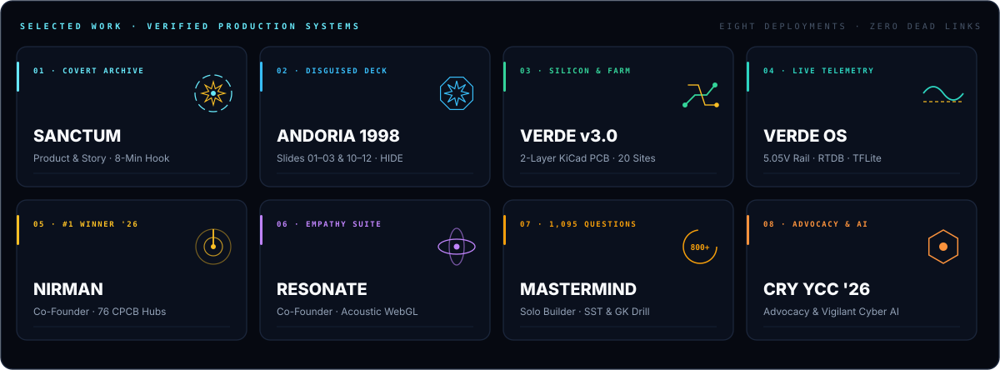

  

 

  

<h1 align="center">AARAV CHOUDHARY</h1>

  <code>CHILD EMPEROR · 002</code> &nbsp;·&nbsp;
  <code>SILICON, PRODUCT &amp; CIVIC SYSTEMS</code> &nbsp;·&nbsp;
  <code>GURUGRAM, INDIA</code>

  <a href="#-selected-work"><b>Selected Work</b></a> &nbsp;·&nbsp;
  <a href="#-field-internships"><b>Internships</b></a> &nbsp;·&nbsp;
  <a href="#-the-doctrine"><b>The Doctrine</b></a> &nbsp;·&nbsp;
  <a href="https://ts-creative-the-protfolio.vercel.app/?unlock"><b>Sanctum</b></a> &nbsp;·&nbsp;
  <a href="https://nirmaan-portfolio-main.vercel.app/team/aarav"><b>Founder Dossier</b></a> &nbsp;·&nbsp;
  <a href="mailto:aaravgurmeet@gmail.com"><b>Email</b></a> &nbsp;·&nbsp;
  <a href="https://devpost.com/aaravgurmeet"><b>Devpost</b></a>

 

  

## ⦿ The Doctrine

**I don't ship slideware. I solder the board underneath it and write the world around it.**

Every system here starts in two places most student builds skip: a real physical or human bottleneck — voltage sag when a pump kicks on, a forty-second citizen drop-off, a confident false memory — and the eight minutes on stage where a room decides whether to care.

> *Don't take a Drive folder. Take the Archive.*

## ⦿ Right Now

  

**[SANCTUM](https://ts-creative-the-protfolio.vercel.app/?unlock)** is a rebellion network hidden behind two dead blogs — three knocks at `0528` kHz, one panic key (`~`), zero trace. **[VERDE v3.0](https://verde-cbse.vercel.app/)** stacks twenty hydroponic sites onto a custom two-layer KiCad PCB with on-device vision that waters itself. **[NIRMAN](https://nirmaan-portfolio-main.vercel.app/)** (*1st Place, DAV E-Colosseum '26*) routes household e-waste to 76 CPCB-certified recyclers in five taps.

## ⦿ Selected Work

  

| | | | |
|---|---|---|---|
| **[SANCTUM ARCHIVE](https://ts-creative-the-protfolio.vercel.app/?unlock)** unlocked command dossier · [0528 door](https://ts-creative.vercel.app/) | **[ANDORIA 1998](https://project-sanctum-ppt.vercel.app/)** disguised finals deck · Fig. 5 × 3 + `HIDE` | **[VERDE v3.0](https://verde-cbse.vercel.app/)** 2-layer KiCad PCB &amp; 20-site farm · [hub](https://verde-main-portfolio.vercel.app/) | **[VERDE OS](https://verde-cbse-app.vercel.app/)** live 5.05V rail, RTDB &amp; TFLite shell |
| **[NIRMAN](https://nirmaan-portfolio-main.vercel.app/)** #1 DAV '26 · [Aarav dossier](https://nirmaan-portfolio-main.vercel.app/team/aarav) | **[RESONATE](https://resonate-preview.vercel.app/)** acoustic sanctuary · [galaxy](https://tapestry-hub-uloe.bolt.host/) · [devpost](https://devpost.com/software/resonate-vn53iz) | **[MASTERMIND](https://quiz-mastermind-aarav.vercel.app/)** 1,095-question finals &amp; GK drill | **[QUIZ CHAMPION](https://i-h-practice-quiz.vercel.app/)** 15 STEM modules &amp; 90s relay · [repo](https://github.com/aarav-choudhary-pro/School-work-) |

## ⦿ Field Internships

  

| Organisation &amp; Role | Field Scope &amp; Live Deliverables |
|---|---|
| **GoSharpener × SOCH** · *Web Development Intern (2025)* | Engineered the official [**"Let's Wake Up" Campaign Portal**](https://soch-wake-up.vercel.app/) — supporting `280+` youth sustainability &amp; mental-health sessions, `8` classroom modules, and `5,00,000+` lives reached across `18+` Indian states. |
| **CRY — Child Rights and You** · *Youth Change Champions '26 Intern (2026)* | Built three interactive advocacy &amp; satirical design portals: [**Week 4 · Policy &amp; "Homework Helmet" Chindogu**](https://act-4-aarav-ycc.vercel.app/) · [**Week 3 · OnlineSafety MissionControl**](https://activity-3-ycc.vercel.app/) · [**Act 01 · Growing Up**](https://act01-growingup.vercel.app/). |
| **Gurugram Police — GPCSSI** · *Cyber Security Summer Intern (1-Month Cohort)* | Attended the month-long **Gurugram Police Cyber Security Summer Internship** — hands-on field immersion in cybercrime analysis, phishing &amp; OSINT reconnaissance, digital forensics fundamentals, and `1930` citizen cyber-safety response. |

## ⦿ Attribute Sheet

  

## ⦿ Beyond the Terminal

Hardware started with a moisture-driven **Smart Irrigation** relay rig in early 2025 before growing into Verde's custom **LM2596 + RS485** board and **OBSIDIAN** (*Team CCA CBSE AI Showcase*). Product intuition came from empirical research into the **DRM False-Memory Paradigm** and national-scale youth advocacy internships. Stage command was forged on the **IIT Delhi MUN (`DISEC`)** floor.

Built alongside **The Council (`Team CCA`)** — [**Jeehaan Kwatra**](https://github.com/AlphabuggOp) (*Design & Motion*) and [**Anuj Phulera**](https://github.com/Anuj-Phulera) (*Systems & Interface*).

Playbooks &amp; Assets: <a href="./docs/OPERATIONS-MANUAL.md"><b>Operator Manual</b></a> · <a href="./docs/PORTFOLIO-MASTERPLAN.md"><b>Portfolio Masterplan</b></a> · <a href="./pfp/"><b>Forged Avatar Vault</b></a>

  
    
  

 

  <a href="https://ts-creative-the-protfolio.vercel.app/?unlock"><b>Sanctum</b></a> &nbsp;·&nbsp;
  <a href="https://verde-cbse.vercel.app/"><b>Verde</b></a> &nbsp;·&nbsp;
  <a href="https://nirmaan-portfolio-main.vercel.app/team/aarav"><b>Nirman</b></a> &nbsp;·&nbsp;
  <a href="https://soch-wake-up.vercel.app/"><b>SOCH</b></a> &nbsp;·&nbsp;
  <a href="https://act-4-aarav-ycc.vercel.app/"><b>CRY '26</b></a> &nbsp;·&nbsp;
  <a href="mailto:aaravgurmeet@gmail.com"><b>aaravgurmeet@gmail.com</b></a> &nbsp;·&nbsp;
  <code>discord: iamaarav_68049</code>

